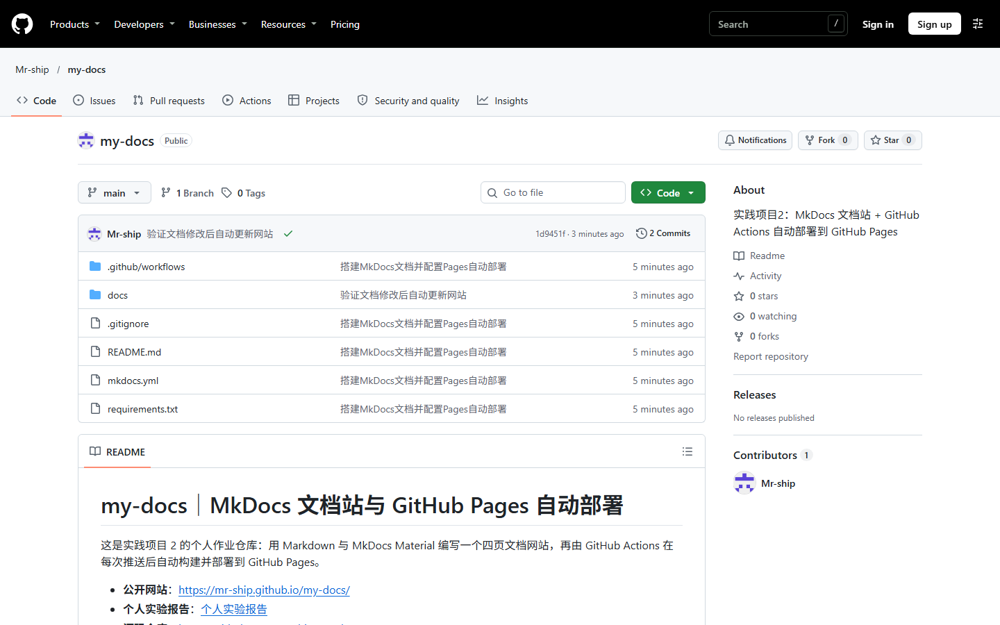
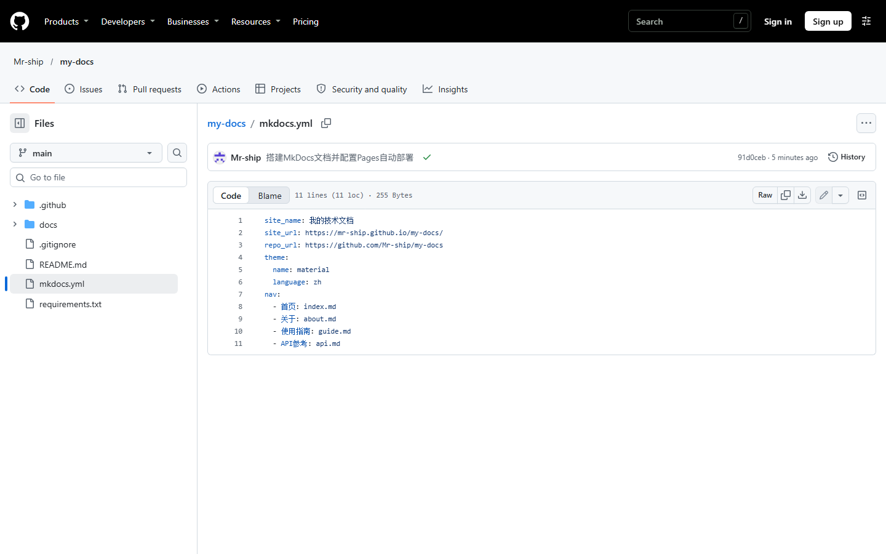
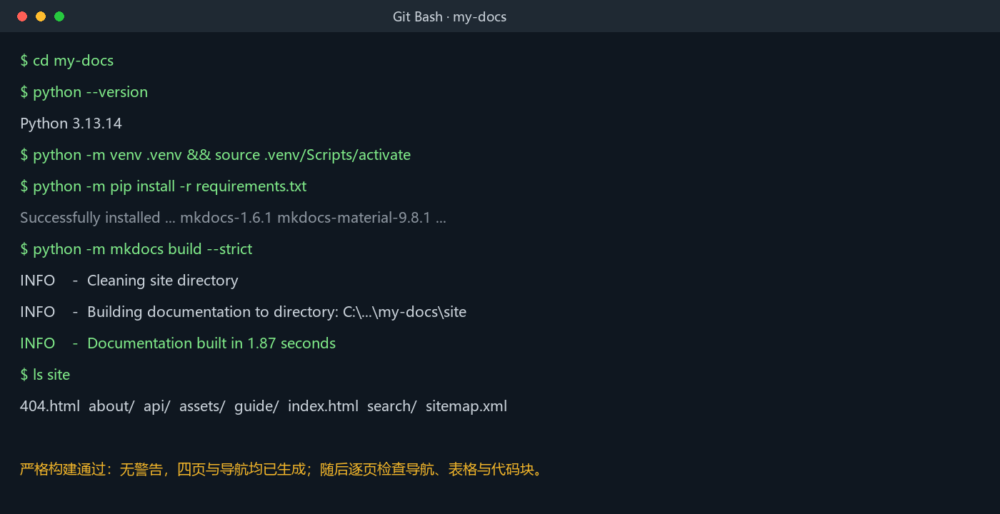
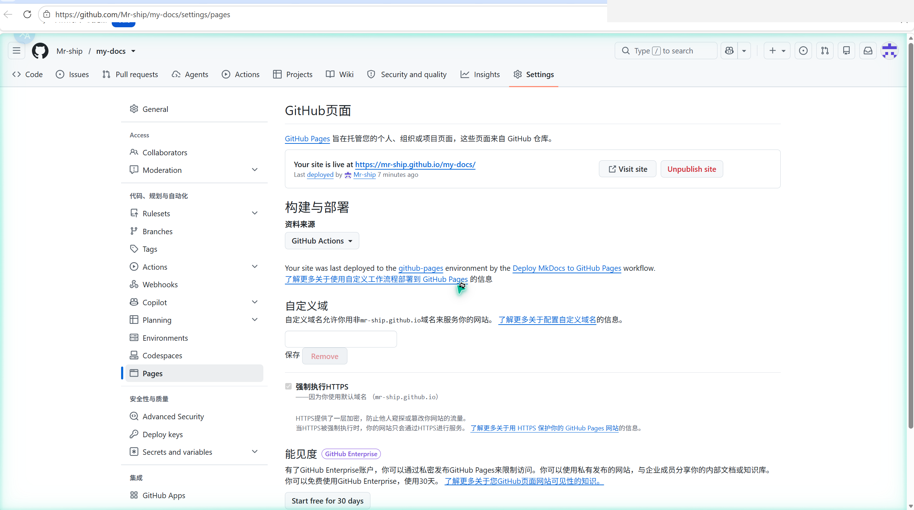
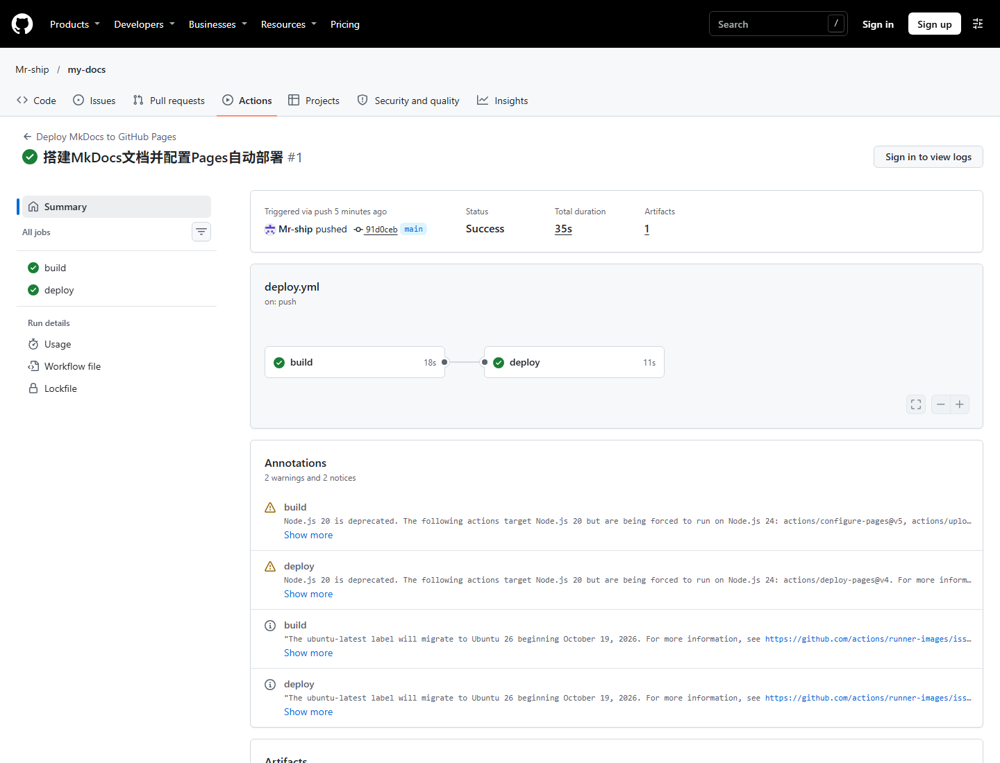
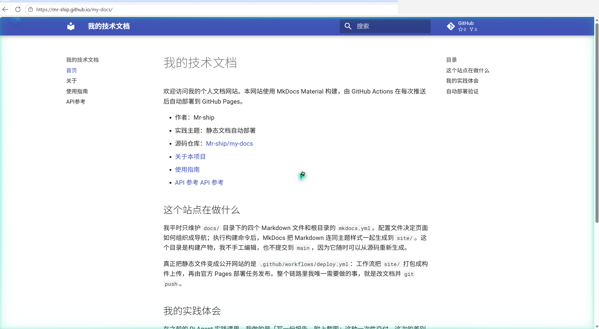
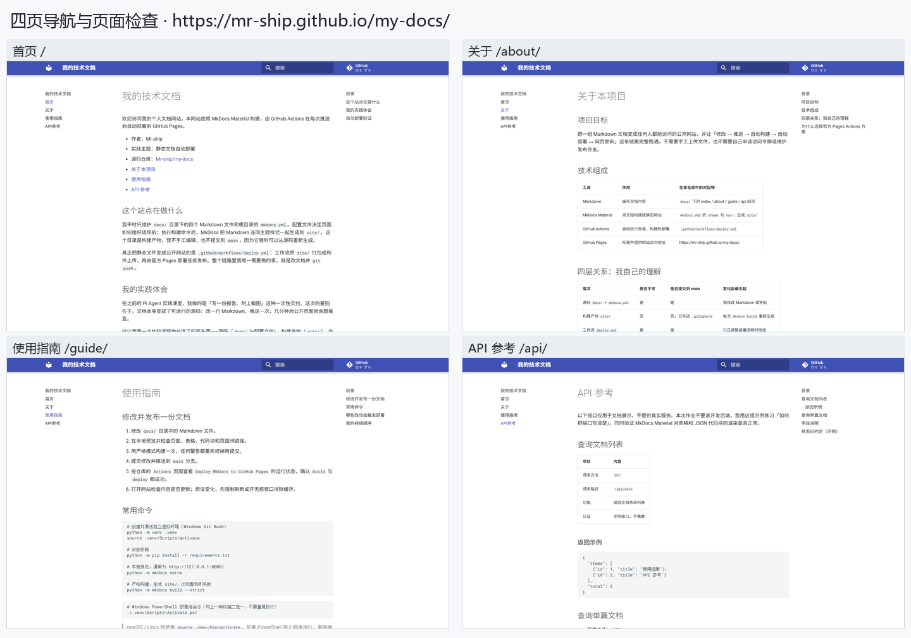
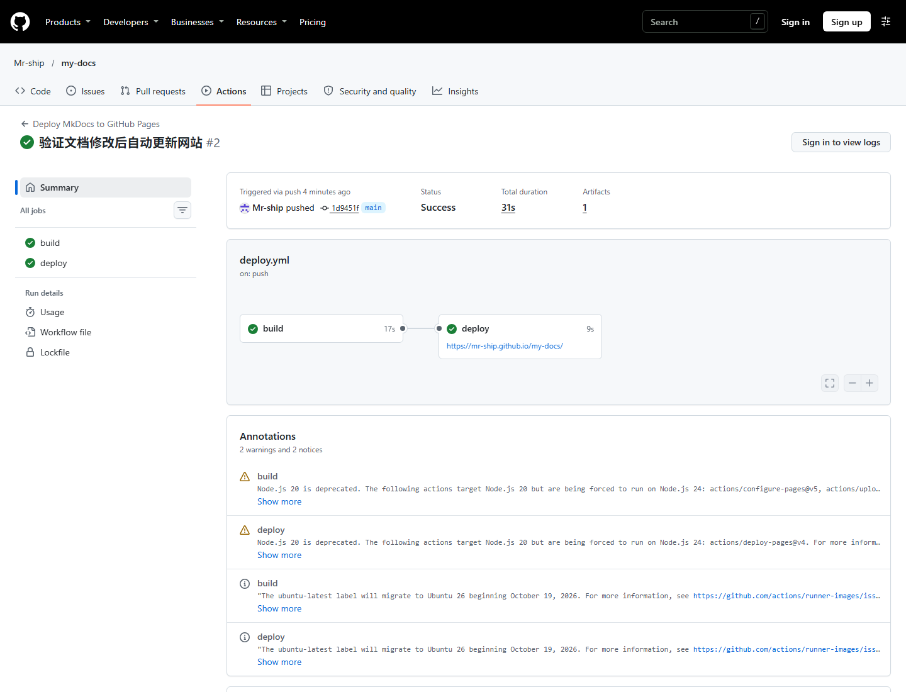
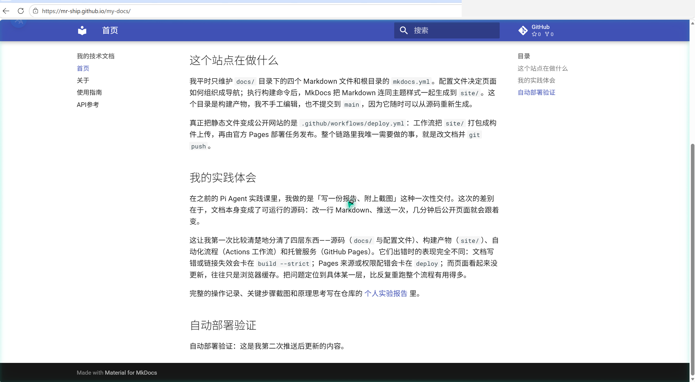

# 实践项目2：个人实验报告

> 通过 GitHub Actions 自动部署 MkDocs 静态文档到 GitHub Pages

## 1. 基本信息

- GitHub 登录名：Mr-ship
- 个人仓库地址：https://github.com/Mr-ship/my-docs
- 最终网站地址：https://mr-ship.github.io/my-docs/
- 实践日期：2026 年 11 月 14 日
- 本地环境：Windows、Git 2.55.0、Python 3.13.14、MkDocs 1.6.1 / Material 9.8.1；CI 环境由工作流固定为 Python 3.12
- 报告与截图目录：`report/`、`report/images/`

## 2. 实践过程与关键截图

### 2.1 仓库创建

**做了什么**：在本人账号下新建公开仓库 `my-docs`，默认分支设为 `main`，并确认所有者、仓库名和 Public 标识。

**为什么**：Pages 项目站点地址与 `用户名.github.io/仓库名/` 绑定；工作流监听的分支也是 `main`，两者必须一致。公开仓库才能免费使用 Pages 对外发布。

**结果**：仓库可公开访问，截图①可看清所有者、仓库名与 Public 标识；本地用 `git init -b main` 初始化，`git branch --show-current` 返回 `main`，与远端默认分支一致。

### 2.2 项目结构与 MkDocs 配置

**做了什么**：按作业要求建立 `docs/`、`report/images/`、`.github/workflows/`，并创建 `mkdocs.yml`、`requirements.txt`、`.gitignore`、根 `README.md`。

**为什么**：

- `docs/` 存放网站源码，四个 Markdown 文件对应四个页面；
- `mkdocs.yml` 的 `nav` 决定导航顺序，路径必须相对 `docs/` 书写（如 `index.md` 而非 `docs/index.md`），YAML 只能用空格缩进；
- `site/` 是 `mkdocs build` 生成的静态产物，可随时重建，因此写进 `.gitignore`，不手工编辑、不提交；
- `report/` 保存过程说明与截图，与网站源码分离。

**结果**：`python -m mkdocs build --strict` 在本地与 CI 均通过，四页导航正常。截图②左侧可见仓库文件树，右侧是 `mkdocs.yml` 的 `site_url`、`theme` 与 `nav` 配置。

### 2.3 本地构建或预览

**做了什么**：创建独立虚拟环境 `.venv`，按 `requirements.txt` 安装 `mkdocs` 与 `mkdocs-material`，执行 `python -m mkdocs build --strict` 严格构建，并用浏览器逐页检查生成的页面与部署后的公开站点。

**为什么**：`--strict` 会把失效的相对链接、导航路径错误变成失败，能在推送前发现问题；虚拟环境避免污染系统 Python。

**结果**：构建成功、无警告（`Documentation built in 1.87 seconds`），产物包含 `index.html` 与 `about/`、`guide/`、`api/` 等目录。逐个检查了首页、关于、使用指南、API 参考四页，重点核对导航跳转、Markdown 表格和 JSON/Bash 代码块的高亮是否正常。

### 2.4 Pages 设置

**做了什么**：在仓库 `Settings → Pages → Build and deployment → Source` 选择 **GitHub Actions**，并确认仓库允许运行工作流。

**为什么**：本方案由工作流上传 `site/` 构件后发布，Pages 必须切换到 Actions 作为发布来源；不需要创建或切换到 `gh-pages` 分支，也不需要把默认权限改成全局读写、不需要勾选「允许创建和批准 PR」。

**结果**：截图④中「资料来源」为 GitHub Actions，页面同时显示 `Your site is live at https://mr-ship.github.io/my-docs/`。最近一次部署由 `Deploy MkDocs to GitHub Pages` 工作流发布到 `github-pages` 环境，可在截图⑤、⑦a 的 Actions 运行记录中核对。工作流中的 `pages: write`、`id-token: write` 只在 `deploy` 任务生效。

### 2.5 Actions 首次构建和部署

**做了什么**：把 `docs/`、`mkdocs.yml`、`requirements.txt`、`.gitignore`、`deploy.yml` 和 README 推送到 `main`，由 `push` 自动触发工作流。

**为什么**：`on.push.paths` 只包含上述路径，所以这次推送会触发；工作流先由 `build` 任务检出源码、配置 Python 3.12、安装依赖、严格构建并上传 `site/` 构件，`needs: build` 保证只有构建成功才进入 `deploy`。

**结果**：`build`（18s）与 `deploy`（11s）均成功，状态为 Success、触发方式为 push，总耗时 35s。首次运行地址：https://github.com/Mr-ship/my-docs/actions/runs/43541575157

### 2.6 网站访问与四页导航检查

**做了什么**：从 `Settings → Pages` 与部署记录取得实际地址，用浏览器逐一打开四页。

**为什么**：必须带仓库路径访问项目站点；资源路径写错时，首页可能正常但子页面样式丢失，需要逐页确认。

**结果**：`/`、`/about/`、`/guide/`、`/api/` 四个地址均返回 200，页面标题分别为「我的技术文档」「关于」「使用指南」「API参考」；左侧导航四页均可跳转，表格、代码块与页面间链接显示正常，样式资源加载正常。截图⑥保留浏览器地址栏，⑥b 是四页的对照检查。

### 2.7 第二次推送与自动更新验证

**做了什么**：在 `docs/index.md` 增加一句本人编写、容易辨认的文字「自动部署验证：这是我第二次推送后更新的内容。」，提交并推送到 `main`，**没有**点击手动运行。

**为什么**：这一步用于证明「推送文档 → 自动构建 → 自动部署 → 网页更新」是 `push` 自动触发的，而不是靠 `workflow_dispatch` 手动触发。

**结果**：新的运行由该次 push 自动触发并成功（`build` 17s、`deploy` 9s）；刷新网站后首页出现新增文字。实验验证阶段的两条运行记录分别对应 `91d0ceb` 与 `1d9451f` 两次提交，事件均为 `push`；之后对 `docs/` 的修改同样由 `push` 继续触发部署，也印证了这条自动更新链路。

- 对应提交链接：https://github.com/Mr-ship/my-docs/commit/1d9451fdd80e6df0a32aacb83452088bf983c6b9
- 对应 Actions 运行链接：https://github.com/Mr-ship/my-docs/actions/runs/43541714720

## 3. 问题与解决

| 现象 | 排查过程 | 原因 | 解决 |
| --- | --- | --- | --- |
| 本地 Python 为 3.13.14，作业说明建议 3.12 | 对比本机 `python --version` 与工作流 `python-version: '3.12'` | 本机版本较新，但依赖约束 `mkdocs>=1.6,<2`、`mkdocs-material>=9.6,<10` 同时兼容 | 本地用 3.13 验证，CI 固定 3.12；两次严格构建均通过，未改动官方工作流 |
| 严格构建可能对相对链接报错 | 预先用 `--strict` 本地构建 | 文档若写 `docs/index.md` 或指向 `docs/` 之外的相对路径，会被判为失效链接 | `nav` 使用相对 `docs/` 的路径；跨目录内容改用仓库完整 URL；构建无警告 |
| 只改报告或 README 后网站没有变化 | 核对 `on.push.paths` 与 Actions 运行列表 | 这两类文件不在触发路径内 | 确认这是设计上的预期行为，自动更新验证只改 `docs/index.md` |
| 刷新后可能看不到新增文字 | 加 `?v=2` 与 `Cache-Control: no-cache` 复核 | CDN / 浏览器缓存旧页面 | 强制刷新或无痕窗口复核，确认新文字已上线 |

上述验证用的两次运行都没有红色失败步骤。我逐项核对了 `build` 与 `deploy` 日志：依赖安装无报错、严格构建无警告、`upload-pages-artifact` 产出 1 个构件、`deploy-pages` 返回页面地址。日志中的 Annotations 是平台级 notice：`actions/configure-pages@v5`、`actions/deploy-pages@v4` 等动作仍以 Node.js 20 为目标、被强制运行到 Node.js 24，以及 `ubuntu-latest` 将迁移到 Ubuntu 26；这两条是弃用/迁移提示，不是失败，因此没有改动作业提供的官方工作流版本。

## 4. 原理理解

**1）`docs/` 和 `site/` 各保存什么？为什么不用手工修改 `site/`？**
`docs/` 保存我手写的 Markdown 源码，`site/` 是 MkDocs 读取源码与 `mkdocs.yml` 后生成的 HTML、CSS、JS 等静态文件。`site/` 完全由源码决定，手工改动会在下一次构建时被覆盖，也无法保证与源码一致；把它交给构建过程并写进 `.gitignore`，可以让仓库只保留唯一的事实来源。

**2）本次工作流在什么情况下自动运行？**
推送到 `main` 且改动命中 `docs/**`、`mkdocs.yml`、`requirements.txt` 或 `.github/workflows/deploy.yml` 时自动运行；此外 `workflow_dispatch` 允许在 Actions 页面手动运行。改 `report/`、`README.md` 或 `site/`（已被忽略）不会触发。

**3）`build` 与 `deploy` 两个任务有什么区别？**
`build` 只做只读的构建工作：检出源码、准备 Python 3.12、安装依赖、`mkdocs build --strict`、上传 `site/` 构件，权限是 `contents: read`。`deploy` 通过 `needs: build` 依赖前者，只有构建成功才执行，它额外持有 `pages: write` 与 `id-token: write`，调用 `actions/deploy-pages` 把构件发布到 `github-pages` 环境。分成两个任务既隔离了权限，也让失败时能一眼看出是「文档构建问题」还是「发布权限/配置问题」。

**4）只修改 `report/README.md` 会触发部署吗？为什么？**
不会。`on.push.paths` 是白名单，`report/README.md` 不在其中；而且报告内容不参与 `site/` 的生成，即便重新部署，网站也不会有任何变化。作业说明也明确提示"只修改报告不会触发部署，这是预期行为"。

**5）本次方案为何无需创建 `gh-pages` 分支？**
分支发布方案是把构建产物提交到 `gh-pages` 分支，再由 Pages 从该分支读取；本方案改用官方 Pages Actions：构建产物作为工作流构件上传，`actions/deploy-pages` 通过 OIDC 令牌直接发布到 Pages 服务，发布来源设为 **GitHub Actions**。产物的传递发生在 Actions 内部，不需要额外分支、不需要推送权限配置，也不需要自己申请或填写访问令牌。

## 5. 截图与链接核对表

| 编号 | 内容 | 文件 |
| --- | --- | --- |
| ① | 个人公开仓库首页（所有者、仓库名、Public） | `images/01-repository.png` |
| ② | 项目目录结构与 `mkdocs.yml` | `images/02-project-structure.png` |
| ③ | 本地严格构建成功的终端记录 | `images/03-local-build.png` |
| ④ | Pages 发布来源为 GitHub Actions | `images/04-pages-source.png` |
| ⑤ | 首次 Actions 成功运行（build + deploy） | `images/05-first-actions-run.png` |
| ⑥ | 公开网站首页、四页导航检查 | `images/06-website.png`、`images/06b-website-pages.png` |
| ⑦ | 第二次 push 的成功运行与网站新增文字 | `images/07a-second-actions-run.png`、`images/07b-website-updated.png` |

关键链接：

- 首次部署运行：https://github.com/Mr-ship/my-docs/actions/runs/43541575157
- 第二次自动部署运行：https://github.com/Mr-ship/my-docs/actions/runs/43541714720
- 第二次推送提交：https://github.com/Mr-ship/my-docs/commit/1d9451fdd80e6df0a32aacb83452088bf983c6b9
- 公开网站：https://mr-ship.github.io/my-docs/

公开报告与 Issue 中不含密码、令牌等敏感信息。
